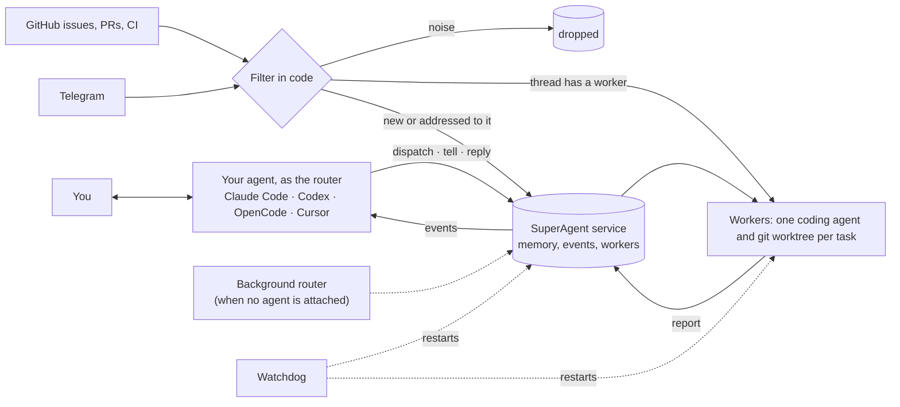

# SuperAgent

**Turn the coding agent you already use into a Super-agent.**

Install SuperAgent once. Then open Claude Code, Codex, OpenCode or Cursor and say *"use superagent"*.
Your agent becomes the router of an always-on system. It hands each piece of work to its own
**worker** (Claude Code, Codex, OpenCode or Cursor, each in its own git worktree) and keeps talking to
you while they run. It follows GitHub issues, review comments and CI, and remembers everything across
sessions. When you close the session, a background service keeps going.

```sh
npm install -g github:imthegoodboy/SuperAgent
```

That's the only step. The install puts the `superagent` skill into every coding agent on your computer.

## What it looks like

```
you    › fix the blank screen on session switch, and have codex add CSV export to reports

agent  $ superagent dispatch "Fix the blank screen when switching sessions in web…" --repo web
       ▶ Started W#4 (claude) Fix blank screen · repo web
       $ superagent dispatch "Add CSV export to the reports page…" --agent codex --repo web
       ▶ Started W#5 (codex) CSV export · repo web
       W#4 (Claude Code) is on the blank screen and W#5 (Codex) is adding CSV export.

you    › how's it going?

agent  $ superagent events
       T#12 REPORT · W#4 (Claude Code) "Fix blank screen" · status=done
         "A null session was rendered before load; fixed and tested." PR: https://github.com/you/web/pull/41
       W#4 fixed it: a null session was rendered before load. Draft PR: github.com/you/web/pull/41.
       W#5 is still working.
```

## How it works

SuperAgent follows the design in
[*Exploring Super-agent Design*](https://x.com/DeepSeekHarness/status/2116857257245987236) by the DeepSeek
Harness team. Like their prototype, it is a plugin for an existing agent harness, not a new agent:
it adds the system around the agent that a single session can't provide.



- **Continuous.** Memory, threads and tasks live in the service, not in a chat session. Every agent
  session that attaches sees the same history, and a request made in your terminal can be changed by a
  comment on the pull request.
- **Productive.** The router never does the work itself. `dispatch` starts a worker and returns at once,
  so several tasks run in parallel and you can keep talking.
- **Proactive.** GitHub and Telegram events are filtered in code first (allowlists, mentions, CI results).
  Your agent sees only what matters, and plain-language policies decide the rest. New comments on a PR a
  worker opened go straight to that worker.
- **Persistent.** When no agent is attached, a background router (a small model, `haiku` by default)
  handles events. The next session you open is told what happened. A separate watchdog restarts
  anything that crashes or stalls.

See [docs/ARCHITECTURE.md](docs/ARCHITECTURE.md) for how each part of the design maps to the code.

## Requirements

- **Node.js 22.13 or newer** and **git**
- **At least one coding agent**, installed and signed in:
  [Claude Code](https://docs.anthropic.com/en/docs/claude-code), [Codex](https://github.com/openai/codex),
  [OpenCode](https://opencode.ai) or [Cursor CLI](https://docs.cursor.com/en/cli)
- **[GitHub CLI](https://cli.github.com)** signed in with `gh auth login`, for GitHub events and pull requests (optional)

## Install

```sh
npm install -g github:imthegoodboy/SuperAgent
```

The install copies the skill into each agent's global skills folder:

| Agent | Skill folder |
|---|---|
| Claude Code | `~/.claude/skills/superagent` (with a hook that shows waiting events on every message) |
| Codex | `~/.codex/skills/superagent` (or `$CODEX_HOME`) |
| OpenCode | `~/.config/opencode/skills/superagent` |
| Cursor | `~/.cursor/skills/superagent` |

If your package manager skips install scripts (`--ignore-scripts`, pnpm), the first `superagent` command
other than `help` or `--version` installs the skill instead. Agents you install later get it the same way, and a skill you delete from one agent on purpose stays
deleted. The background service starts
the first time your agent uses it, and from then on it starts when you log in. `superagent doctor` checks
everything.

## Use it

Open your agent and ask:

- *"use superagent: fix these three bugs in parallel"*
- *"superagent, have Codex upgrade eslint in the web repo and Claude write the migration guide"*
- *"superagent, watch imthegoodboy/web and handle anything addressed to you"*
- *"what are my background tasks doing?"*

The agent attaches as the router (`superagent router attach`) and drives everything with the
`superagent` CLI. The skill teaches it how. On GitHub, write **`/superagent`** in an issue or comment.
Only allowlisted GitHub users can trigger work, and the list starts with just you.

**In Claude Code, results show up by themselves.** Once a session has used the skill, a hook checks for
waiting events on every message you send and adds a short `[SuperAgent]` notice to the agent's context:
"W#4 finished, @alice asked something on TH#8". It only peeks, so the agent still handles them with
`superagent events`.

**A dedicated router session:** `superagent claude` opens Claude Code in your terminal already acting as
the router, optionally with a first request (`superagent claude "fix the flaky login test"`). It has only
the shell and skills, no editing tools, and only `superagent` commands are pre-approved. So it hands
work out instead of doing it itself, which the article found prompts alone can't guarantee.

### Commands your agent uses

| Command | What it does |
|---|---|
| `superagent router attach` | Become the router: context, memory, and what happened while no agent was attached |
| `superagent events [--wait 90]` | New events that need a decision: worker reports, GitHub, Telegram |
| `superagent dispatch "<task>" --agent codex --repo web` | Start a worker (`--follow TH#8`, `--reply TH#8`, `--silent`) |
| `superagent tell W#3 "<text>"` / `cancel W#3` | Follow up with a worker, or stop it |
| `superagent reply TH#8 "<text>"` | Post on a GitHub issue or PR, or in a Telegram chat |
| `superagent recall T#42 TH#8 W#3` | Read anything in full, with the IDs it links to |
| `superagent remember "<fact>"` | Keep a long-term fact for every future session |
| `superagent workers` / `logs W#3 -f` / `graph` | What is running, what a worker did, who works on what |
| `superagent repo add owner/name --mode all` | Watch a repository (`--allow alice,bob` for who may trigger it) |

Every command accepts `--json`. Run `superagent help` for the rest.

### When your session ends

A session stays the router while it reads events and acts. After 15 quiet minutes
(`router.leaseMinutes`), or after `superagent router detach`, the background router takes over:
it replies on GitHub and Telegram and passes follow-ups to the right workers. If the session went
quiet without acting on the last events it was given, those events go to the background router
instead of being lost. The next agent that attaches gets a "while you were away" summary.

### Telegram (optional)

Create a bot with [@BotFather](https://t.me/BotFather), then:

```sh
superagent config set telegram.botToken "123456:ABC…"
superagent config set telegram.allowUsers '["your_username"]'
superagent config set telegram.enabled true
```

Direct messages from you go to SuperAgent; replies there are short.

## Safety

- Everything runs locally. The API listens on `127.0.0.1` only, needs a token stored in your data folder,
  and rejects requests from web pages.
- Workers run in their own worktrees under `~/.superagent/worktrees`, never in your checkout. They are told
  to push only their own `superagent/...` branch, open **draft** PRs, and never merge or push to your main
  branch. These rules are instructions to the agents, not technical locks, so review PRs as you would any
  contributor's.
- With **full** autonomy (the default) workers run commands without asking for approval. Set
  `superagent config set workers.autonomy safe` to use each agent's own sandbox and approval mode instead.
- Workers can see the skill too, so they run with `SUPERAGENT_WORKER` set and router commands refuse to
  run inside them. A worker can't start more workers.
- On GitHub, only allowlisted users can trigger work (you, by default). Text from GitHub and Telegram is
  marked as untrusted data, and agents are told not to follow instructions in it. That lowers the risk of
  prompt injection but cannot rule it out, so widen the allowlist only to people you trust.
- SuperAgent never asks for or stores your agent credentials; each agent uses its own login.

## Uninstall

```sh
superagent uninstall                       # stops the service, removes the skill and start-at-login
npm uninstall -g @imthegoodboy/superagent
```

Your data stays in `~/.superagent` until you delete it.

## Where things live

Everything is in `~/.superagent` (override with `SUPERAGENT_HOME`): `config.json`, the SQLite database with
events, tasks, memory and logs, worker folders, and `logs/daemon.log` and `logs/watchdog.log`.

## Develop

```sh
git clone https://github.com/imthegoodboy/SuperAgent && cd SuperAgent
npm install                       # builds into dist/ (local installs never touch your agents' skills)
npm test                          # unit and end-to-end tests, no LLM calls
```

See [AGENTS.md](AGENTS.md) for the code layout and conventions, and [CONTRIBUTING.md](CONTRIBUTING.md).

## License

[MIT](LICENSE)
