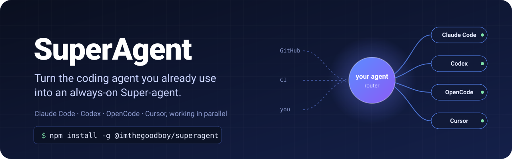

<p align="center">
  
</p>

<p align="center">
  <a href="https://www.npmjs.com/package/@phigon/superagent"></a>
  <a href="https://github.com/imthegoodboy/SuperAgent/actions/workflows/ci.yml"></a>
  <a href="LICENSE"></a>
</p>

# SuperAgent

**Turn the coding agent you already use into a Super-agent.**

Install SuperAgent once, then tell Claude Code, Codex, OpenCode or Cursor to *"use superagent"*. Your agent
becomes a manager of other coding agents:

- **It hands out work.** Each task goes to its own worker (Claude Code, Codex, OpenCode or Cursor), on its
  own git branch (or in a scratch folder when no repository is involved), with several running at once.
- **It keeps talking to you while they work.** Results come back as they finish.
- **It watches GitHub for you.** It reacts to issues, review comments and failing CI, and follows up on the
  pull requests its workers open.
- **It remembers everything** across sessions, and keeps going in the background after you close the
  terminal.

You talk to one agent; SuperAgent runs the rest.

## Install

```sh
npm install -g @phigon/superagent && superagent install
```

That's the only step. `superagent install` adds the `superagent` skill to every coding agent on your
computer: Claude Code, Codex, OpenCode and Cursor. Recent npm versions don't run install scripts for global
packages, so this is done by a command instead. The background service starts by itself the first time
your agent uses it.

You need **Node.js 22.13+**, **git**, and at least one coding agent signed in:
[Claude Code](https://docs.anthropic.com/en/docs/claude-code), [Codex](https://github.com/openai/codex),
[OpenCode](https://opencode.ai) or [Cursor CLI](https://docs.cursor.com/en/cli). For GitHub features, also
sign in to the [GitHub CLI](https://cli.github.com) with `gh auth login`.

Check everything with:

```sh
superagent doctor
```

## Use it

Open your agent in a project and ask in plain words:

> **use superagent:** fix the flaky login test, and have Codex add CSV export to the reports page

```
agent  ▶ Started W#4 (claude) Fix flaky login test · repo web
       ▶ Started W#5 (codex) CSV export · repo web
       W#4 (Claude Code) is on the login test and W#5 (Codex) is adding CSV export.
       What's next?
```

Keep working with your agent meanwhile. When a worker finishes, the agent tells you:

```
agent  W#4 fixed it: the test raced the session refresh; it now waits for it.
       Draft PR: github.com/you/web/pull/41. W#5 is still working.
```

More things to ask:

- *"superagent: upgrade eslint in this repo and fix the new warnings"*
- *"superagent: have Claude write the migration guide while Codex updates the API"*
- *"superagent: watch imthegoodboy/web and handle anything addressed to you"*
- *"what are my background tasks doing?"* · *"what did W#4 change?"* · *"stop W#5"*
- *"remember that we deploy on Fridays"*

### Even better in Claude Code

- **Results show up by themselves.** In the Claude Code session that is managing your work, finished
  work, questions from workers and new GitHub comments appear on your next message, with no need to ask.
  This needs a Claude Code version with skill hooks (2.1 or newer).
- **A dedicated manager session.** Run `superagent claude` (optionally with a first request) to open Claude
  Code as the manager. Its file-editing tools are switched off and MCP servers aren't loaded, so it hands
  every task to a worker instead of doing it itself.

  ```sh
  superagent claude "fix the flaky login test and update the changelog"
  ```

## What it does for you

| | |
|---|---|
| **Parallel work** | Several tasks at once, each in its own worktree and branch, never touching your checkout. |
| **Any agent, mixed** | Pick the agent per task ("use Codex for this") or let SuperAgent choose. |
| **Pull requests** | In GitHub repos, workers push their branch and open a **draft** PR when done (unless you turn that off). |
| **Follow-ups** | Review comments and failing CI on a worker's PR go straight back to that worker. |
| **GitHub on autopilot** | Write `/superagent` in an issue or comment to call it, or let it watch a repo. |
| **Background** | Close the terminal and it keeps handling GitHub and Telegram. Next time you get a "while you were away" summary. |
| **Memory** | Decisions and preferences are remembered for every future session. |
| **Self-healing** | A watchdog restarts anything that crashes or gets stuck. |

## Setup

Most things work without setup. These commands are for when you want more. Your agent can run them
for you too.

**Repositories.** Tasks for the folder you're in, or for any `owner/repo`, just work: the repository is
added the first time. To set one up yourself, or to watch GitHub:

```sh
superagent repo add .                          # this project
superagent repo add owner/name                 # a GitHub repo (cloned on first use)
superagent repo add owner/name --mode all      # react to every issue and comment, not only mentions
superagent repo add owner/name --allow alice,bob   # who may trigger it on GitHub (default: only you)
superagent repo list
```

**Settings**

```sh
superagent config set workers.maxConcurrent 4      # tasks at the same time (default 3)
superagent config set workers.defaultAgent codex    # agent used when you don't pick one
superagent config set workers.autonomy safe         # use each agent's own sandbox and approvals
superagent config set workers.allowDraftPRs false   # workers commit locally, no PRs
superagent config set router.model sonnet           # model for the background router (default haiku)
superagent config set workers.minFreeMemoryMB 600   # wait to start more workers below this free memory
superagent config                                   # show everything
```

**Telegram (optional).** Create a bot with [@BotFather](https://t.me/BotFather), then:

```sh
superagent config set telegram.botToken "123456:ABC…"
superagent config set telegram.allowUsers '["your_username"]'
superagent config set telegram.enabled true
```

**Start at login** is turned on the first time SuperAgent starts. Change it with
`superagent autostart off` (or `on`).

## Commands

Your agent uses these through the skill. You can run them yourself too.

| Command | What it does |
|---|---|
| `superagent dispatch "<task>"` | Start a worker (`--agent codex`, `--repo .`, `--title …`) |
| `superagent events` | New results, questions and GitHub activity |
| `superagent workers` | What every worker is doing |
| `superagent diff W#4` | What a worker changed (`--patch` for the full diff) |
| `superagent logs W#4 -f` | Follow a worker live |
| `superagent tell W#4 "<text>"` | Give a worker more instructions |
| `superagent cancel W#4` · `retry W#4` | Stop a worker, or run it again |
| `superagent cleanup` | Archive workers that finished more than a week ago |
| `superagent graph` | Who is working on what |
| `superagent remember "<fact>"` | Remember something for every future session |
| `superagent status` · `doctor` | Check that everything is running |
| `superagent claude` | Open Claude Code as the manager |
| `superagent help` | All commands |

Every command accepts `--json`.

## Safety

- **It runs on your computer.** No accounts and no servers of ours. The service only listens on
  `127.0.0.1` and needs a local key. GitHub and Telegram features talk to those services with your own
  logins, and your coding agents use their usual providers.
- **Your checkout is never touched.** Workers get their own worktrees under `~/.superagent/worktrees`.
  They push only their own `superagent/...` branch, open **draft** PRs (by default), and never merge or push
  to your main branch. Review their PRs as you would anyone's.
- **Full autonomy is the default:** workers run commands without asking. For each agent's own sandbox
  and approvals, run `superagent config set workers.autonomy safe`.
- **Only you can trigger it on GitHub**, unless you add people with `--allow`. If SuperAgent can't tell who
  you are (`gh` signed out), GitHub events stay off for that repo. Text from GitHub and Telegram is
  treated as untrusted data.
- SuperAgent never sees your agent logins; each agent uses its own.

## Troubleshooting

| Problem | Try |
|---|---|
| Something isn't working | `superagent doctor` (also checks each agent is signed in) |
| Changed `port` | `superagent restart`; until then the service keeps its old port |
| A worker seems stuck | `superagent logs W#4`, then `superagent retry W#4` |
| Just upgraded | `superagent restart`, so the background service runs the new version |
| GitHub events don't arrive | `gh auth status`; check `superagent activity` to see why an event was skipped |
| Service logs | `superagent logs` (or `~/.superagent/logs/`) |

## Update and uninstall

```sh
npm install -g @phigon/superagent@latest && superagent install && superagent restart   # update

superagent uninstall                         # stop it, remove the skill and start-at-login
npm uninstall -g @phigon/superagent    # then remove the command
```

Your data (tasks, memory, logs) stays in `~/.superagent` until you delete it.

## Contributing

```sh
git clone https://github.com/imthegoodboy/SuperAgent && cd SuperAgent
npm install && npm test
```

See [CONTRIBUTING.md](CONTRIBUTING.md). SuperAgent follows the design in DeepSeek Harness's
[*Exploring Super-agent Design*](https://x.com/DeepSeekHarness/status/2116857257245987236). If you want the
internals, [docs/ARCHITECTURE.md](docs/ARCHITECTURE.md) maps it to the code.

## License

[MIT](LICENSE)
