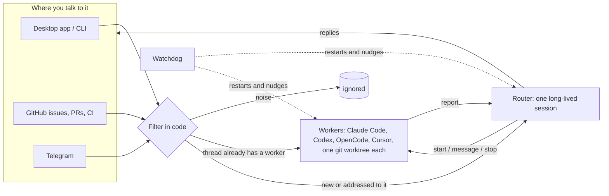

# SuperAgent

**One always-on agent that runs your coding agents in parallel, on your own computer.**

You talk to one agent, in the desktop app, the terminal, GitHub or Telegram. Behind it, SuperAgent
hands each piece of work to **Claude Code, Codex, OpenCode or Cursor**, runs several of them at once
in separate git worktrees, follows up on review comments and failing CI by itself, and reports back
in the same conversation. No accounts, no servers, no sign-in: it uses the agents and the `gh` login
you already have.

```
you › fix the blank screen on session switch, and have codex add CSV export to reports
superagent › On it. W12 (Claude Code) is on the blank screen, W13 (Codex) is adding CSV export.
  · Finished W12 · Fix blank screen on session switch
superagent › W12 fixed it: a null session was rendered before load. Draft PR: github.com/you/app/pull/41
```

## How it works



- **One continuous agent.** A single long-lived router session sees every channel, so you can ask for
  plan A in the app and switch to plan B in a PR comment. It never does the work itself; it only talks
  to you and hands out tasks, so it stays fast.
- **Parallel workers.** Each task runs in a headless coding agent with its own git worktree and branch.
  When a worker opens a pull request it follows that PR: review comments and failing CI go straight
  back to it, without passing through the router.
- **Event-driven.** GitHub events and chat messages are filtered in code first (allowlists, mentions,
  CI results), so the model only sees what matters. Plain-language policies decide the rest, for example
  "if someone reports a clear bug, quietly try to fix it".
- **Never blocks.** You can keep chatting while workers run. Results arrive as messages.
- **Recovers on its own.** A separate watchdog process restarts the daemon if it crashes or hangs,
  restarts stuck workers, and asks a model whether long tasks are still making progress.

The design follows [*Exploring Super-agent Design*](https://x.com/DeepSeekHarness/status/2116857257245987236)
by the DeepSeek Harness team, adapted to run entirely on your machine. See
[docs/ARCHITECTURE.md](docs/ARCHITECTURE.md) for how each idea maps to the code.

## Install

You need:

- **Node.js 22.13 or newer**
- **git**
- **At least one coding agent**, installed and signed in:
  [Claude Code](https://docs.anthropic.com/en/docs/claude-code), [Codex](https://github.com/openai/codex),
  [OpenCode](https://opencode.ai) or [Cursor Agent](https://docs.cursor.com/en/cli)
- **[GitHub CLI](https://cli.github.com)** signed in with `gh auth login`, for GitHub triggers and pull requests (optional)

```sh
npm install -g github:imthegoodboy/SuperAgent
superagent doctor     # checks everything above
superagent start      # starts the daemon and its watchdog in the background
superagent open       # opens the app in your browser
```

**Desktop app:** download the installer for your system from
[Releases](https://github.com/imthegoodboy/SuperAgent/releases). It starts SuperAgent if it isn't
running and shows the same app in its own window. It needs the CLI above.

To have SuperAgent start when you log in: `superagent autostart on`.

## Use it

**Chat.** Ask in plain words in the app or with `superagent chat`. Name an agent if you want a specific
one ("use Codex", "with OpenCode").

**Add your repositories** so workers can branch, commit and open draft PRs:

```sh
superagent repo add .                    # the repo you're in
superagent repo add owner/name           # cloned on first use
superagent repo add owner/name --mode all   # consider every issue and comment, not only mentions
```

On GitHub, write **`/superagent`** in an issue or comment to call it. Only allowlisted GitHub users
can trigger it, and the list starts with just you, so `--mode all` watches *your* activity until you
add people with `--allow alice,bob` or in Settings.

**From the terminal:**

| Command | What it does |
|---|---|
| `superagent chat` | Interactive chat with SuperAgent |
| `superagent say "<message>"` | Send one message and print the reply |
| `superagent run "<task>" --agent codex --repo web` | Start a worker directly (`--wait` to block until it's done) |
| `superagent tasks` | List workers with status, agent and PR |
| `superagent logs W3 -f` | Follow what a worker is doing |
| `superagent msg W3 "<text>"` | Send a worker a follow-up |
| `superagent cancel W3` / `retry W3` / `archive W3` | Stop, rerun, or remove its workspace |
| `superagent status` / `stop` / `restart` | Manage the background service |
| `superagent agents` / `doctor` | Check agents and setup |
| `superagent config set workers.maxConcurrent 4` | Change a setting |

**From Claude Code or Codex:** install the skill with `superagent skill install` (or `--codex`), then
say things like "/superagent have Codex upgrade eslint in the web repo".

**Telegram (optional):** create a bot with [@BotFather](https://t.me/BotFather), paste the token in
Settings → Where it listens, and add your username. Direct messages from you go to SuperAgent;
replies are short.

## Safety

- Everything runs locally. The API listens on `127.0.0.1` only, needs a token stored in your data
  folder, and rejects requests from other websites. The desktop app and `superagent open` hand the
  token to the page once; the page itself never contains it.
- Workers run in their own worktrees under `~/.superagent/worktrees`, never in your checkout. They are
  told to push only their own `superagent/...` branch, open **draft** PRs, and never merge or push to
  your main branch. These rules are instructions to the agents, not technical locks, so review PRs as you
  would any contributor's.
- With **Full** autonomy (the default) agents run commands without asking for approval. Choose
  **Safe** in Settings to use each agent's own sandbox and approval mode instead.
- On GitHub, only allowlisted users can trigger work (you, by default). Text from GitHub and Telegram
  is marked as untrusted data in the router's and workers' prompts, and they are told not to follow
  instructions in it. That lowers the risk of prompt injection but cannot rule it out, which is why the
  allowlist starts with just you. Widen it only to people you trust.
- SuperAgent never asks for or stores your agent credentials; each agent uses its own login.

## Where things live

Everything is in `~/.superagent` (override with `SUPERAGENT_HOME`): `config.json`, the SQLite database
with conversations, tasks and logs, worker folders, and `logs/daemon.log` and `logs/watchdog.log`.

## Develop

```sh
git clone https://github.com/imthegoodboy/SuperAgent && cd SuperAgent
npm install                       # builds into dist/
npm test                          # unit and end-to-end tests, no LLM calls
SUPERAGENT_HOME=/tmp/sa SUPERAGENT_MOCK=1 node dist/cli.js __daemon   # isolated daemon with a fake agent
cd desktop && npm install && npm run dev                              # desktop app (needs Rust)
```

See [AGENTS.md](AGENTS.md) for the code layout and conventions, and [CONTRIBUTING.md](CONTRIBUTING.md).

## License

[MIT](LICENSE)
